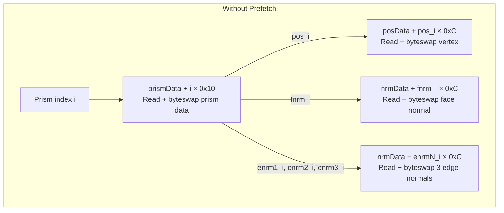
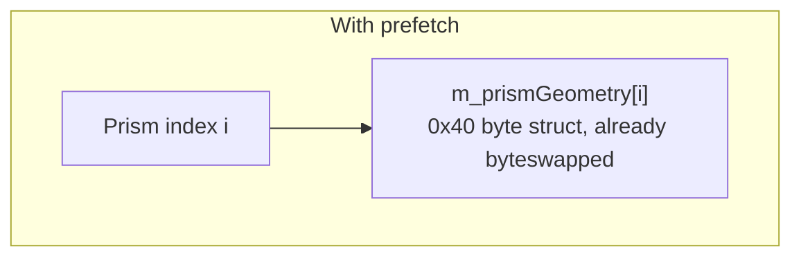

# Performance Optimizations {#perfoptimization}

Since %Kinoko does not aim to be a byte-matching decompilation, we can take creative liberty for the sake of improving performance. This page lists all performance optimizations that were added to %Kinoko, ordered roughly in terms of largest to smallest improvement.


---

## <small>[[#533](https://github.com/vabold/Kinoko/pull/533)]</small> KCL Prism Prefetch {#perfoptimization_prism_prefetch}

`.kcl` files are comprised of multiple different sections. In brief, the following sections are relevant:
- The header (@ref Kinoko::Field::KColData::KColHeader "KColHeader")
- **Section 1:** Vertex position vectors
- **Section 2:** Prism normal vectors
- **Section 3:** Array of prisms (@ref Kinoko::Field::KColData::KCollisionPrism "KCollisionPrism")

The header contains offsets to each of the above sections within the file. Each individual prism stores the following:
- Index into section 1 for the first vertex's position
- Index into section 2 for the prism's face normal
- Index into section 2 for the prism's first edge normal
- Index into section 2 for the prism's second edge normal
- Index into section 2 for the prism's third edge normal
- The prism's attributes

Since a prism maps to its vertices and normals using indices into their respective file sections, accessing them requires pointer arithmetic overhead to seek throughout the file data, every time the game checks for collision against a KCL prism. Not only that, but the indices and the prism's attributes are stored as big-endian, which means that all reads must @ref Kinoko::parse() "byteswap" the value to the endianness of the system running %Kinoko.



We can eliminate this overhead by pre-emptively fetching and byteswapping the vertex position and normals for all prisms, such that they can all exist in a struct that is contiguous in memory. With the prism data now existing in a `0x40` byte struct in memory, cache locality results in a substantial speedup. In order to preserve this cache locality, we store the prefetched and byteswapped prism attributes in a separate array. Though this all results in slightly longer race initialization time, this is negligible given that KCL collision checks are the hottest path when profiling.



@see @ref Kinoko::Field::KColData "KColData" | @ref Kinoko::Field::KColData::KColHeader "KColHeader" | @ref Kinoko::Field::KColData::KCollisionPrism "KCollisionPrism" | @ref Kinoko::Field::KColData::KCollisionPrismGeometry "KCollisionPrismGeometry"

---

## <small>[[#534](https://github.com/vabold/Kinoko/pull/534)]</small> Skip KartCamera Calculation {#perfoptimization_kartcamera}

@ref Kinoko::Render::KartCamera "KartCamera" is responsible for computing the position and rotation of the front-facing and rear-facing cameras that follow the player. While it may initially seem that there is no need to implement this class for %Kinoko, @ref Kinoko::Render::KartCamera "KartCamera" actually performs collision checks to handle cases where there may be a surface that lies between the player and the camera. This collision check can result in updates to a @ref Kinoko::Field::ObjectKCL "ObjectKCL's" collision transform matrix in @ref Kinoko::Field::ObjColMgr "ObjColMgr". Since the camera lies behind the player, the camera can update objects behind the player in scenarios where the kart's collision checks do not reach the object.

Since @ref Kinoko::Render::KartCamera "KartCamera" was only implemented for these drivable objects, we can skip over per-frame calculation of the camera for courses which do not have any drivable objects. This is observed via @ref Kinoko::Field::ObjectDrivableDirector::hasCalcObjects "ObjectDrivableDirector::hasCalcObjects()". This offers a significant speedup since two collision checks are now skipped per-frame.

@see @ref Kinoko::Render::KartCamera | @ref Kinoko::Field::ObjectKCL::checkCollision "ObjectKCL::checkCollision" | @ref Kinoko::Field::ObjColMgr "ObjColMgr"

---

## <small>[[#546](https://github.com/vabold/Kinoko/pull/546)]</small> KCL Early Plane Distance Check {#perfoptimization_earlyplane}

In the base game, @ref Kinoko::Field::KColData::checkSphereCollision(Kinoko::u16,Kinoko::f32*,Kinoko::EGG::Vector3f*,Kinoko::u16*) "KColData::checkSphereCollision" and @ref Kinoko::Field::KColData::checkPointCollision(Kinoko::u16,Kinoko::f32*,Kinoko::EGG::Vector3f*,Kinoko::u16*,bool) "KColData::checkPointCollision" normally check the kart/object's relative position from each edge of the prism and THEN check to see if the kart/object lies in front of the prism's plane.

We find that performing the plane distance check earlier, such that it preempts the edge distance checks, yields a sizable performance improvement, demonstrating that this is a more common collision check failure branch than the edge distance checks.

Our current understanding for why this is faster is because this is a broader check than the edge checks.
- Wall prism face normals most commonly point somewhere in the XZ plane, which means the wall's face plane is the Y-axis. In this case, checking that the kart's/object's sphere lies in front of the wall's plane means that the kart/object is not colliding with the wall.
- Similarly, the kart's body usually does not contact the floor; rather, the tires are more commonly colliding with floor prisms. This means that this broader check can eliminate scenarios where the kart's body is not actually contacting the floor, without having to check multiple edge distances.

@see @ref Kinoko::Field::KColData::checkSphereCollision(Kinoko::u16,Kinoko::f32*,Kinoko::EGG::Vector3f*,Kinoko::u16*) "KColData::checkSphereCollision" | @ref Kinoko::Field::KColData::checkPointCollision(Kinoko::u16,Kinoko::f32*,Kinoko::EGG::Vector3f*,Kinoko::u16*,bool) "KColData::checkPointCollision"

---

## KCL Early Inside Check {#perfoptimization_earlyinside}

In @ref Kinoko::Field::KColData::checkSphereCollision(Kinoko::u16,Kinoko::f32*,Kinoko::EGG::Vector3f*,Kinoko::u16*) "KColData::checkSphereCollision", the game determines which prism edge is the furthest and closest to the player. After doing so, it checks to see if the kart's/object's sphere lies entirely within the prism. If it does, then it enters an early return branch.

Checking to see if the sphere lies entirely within the prism can be performed without having to first rank the distances of the prism edges. Moving this check before the edge sorting yields a small performance improvement.

@snippet KColData.cc early_inside_check

@see @ref Kinoko::Field::KColData::checkSphereCollision(Kinoko::u16,Kinoko::f32*,Kinoko::EGG::Vector3f*,Kinoko::u16*) "KColData::checkSphereCollision" 

---

## <small>[[#549](https://github.com/vabold/Kinoko/pull/549)]</small> Narrow CalcTriggers Collision Check Mask {#perfoptimization_calctrigger}

@note THIS FUNCTION WAS RENAMED IN THE DOXYGEN_ENHANCE BRANCH.

@ref Kinoko::Kart::KartCollide::calcFloorEffect() "KartCollide::calcFloorEffect()" calls @ref Kinoko::Kart::KartCollide::calcLeanCollision() "KartCollide::calcLeanCollision()" twice, once for direction-specific KCL types, and once for non-directional KCL types. However, for the purposes of %Kinoko, we only care about @ref KCL_TYPE_WALL and @ref COL_TYPE_SOLID_OOB for the non-directional call. As such, we can actually narrow the KCL flags that the base game normally uses (@ref KCL_TYPE_NON_DIRECTIONAL) for the non-directional scenario such that we only check for @ref KCL_TYPE_WALL and @ref COL_TYPE_SOLID_OOB. This narrowing results in a 2% performance improvement.

@see @ref Kinoko::Kart::KartCollide::calcLeanCollision() "KartCollide::calcLeanCollision()" | @ref KCL_TYPE_NON_DIRECTIONAL | @ref KCL_TYPE_WALL | @ref COL_TYPE_SOLID_OOB

---

## <small>[[#523](https://github.com/vabold/Kinoko/pull/523)]</small> Cache World Intertia Tensor {#perfoptimization_inertia_tensor}

In @ref Kinoko::Kart::KartCollide::applySomeFloorMoment() "KartCollide::applySomeFloorMoment()", the game computes a matrix that represents the kart's inertia tensor in world space. This function is called once per tire per frame.

Since the matrix is dependent on the kart's rotation and local inertia tensor which don't change on a per-tire basis, we introduce a new function @ref Kinoko::Kart::KartDynamics::calcWorldInertiaTensor() "KartDynamics::calcWorldInertiaTensor()" which can be used to compute the matrix once, so that it can be re-used in @ref Kinoko::Kart::KartCollide::applySomeFloorMoment() "KartCollide::applySomeFloorMoment()" for each tire. This results in a 1.3% performance boost.

@see @ref Kinoko::Kart::KartCollide::applySomeFloorMoment() "KartCollide::applySomeFloorMoment()" | @ref Kinoko::Kart::KartDynamics::calcWorldInertiaTensor() "KartDynamics::calcWorldInertiaTensor()"

---

## <small>[[#543](https://github.com/vabold/Kinoko/pull/543)]</small> Skip Lakitu Calculation {#perfoptimization_lakitu}

For the same reasons as @ref perfoptimization_kartcamera "the KartCamera section above", we can skip updates to Lakitu's state management when there are no drivable objects on the loaded course. This is about a 1% performance improvement when averaged across all tracks.

@see @ref Kinoko::Field::JugemDirector "JugemDirector"

---

## <small>[[#542](https://github.com/vabold/Kinoko/pull/542)]</small> Skip Seagull Calculation {#perfoptimization_seagull}

For the same reasons as @ref perfoptimization_kartcamera "the KartCamera" and @ref perfoptimization_lakitu "the Lakitu" sections above, we can also skip updates to @ref Kinoko::Field::ObjectBird "ObjectBird" calculation if there are no drivable objects.

@see @ref Kinoko::Field::ObjectBird "ObjectBird"

---

## <small>[[#538](https://github.com/vabold/Kinoko/pull/538)]</small> Skip Multiplayer Hitbox Calc {#perfoptimization_hitbox_calc}

In the first pass of the kart's physics calculation (@ref Kinoko::Kart::KartSub::calcPass0() "calcPass0()"), the base game normally calls a function which updates all of the kart body's hitbox positions. This call exists in the base game so that intra-player collision checks can occur with up-to-date hitbox positions, but since %Kinoko does not support multiplayer, we can remove the call; the kart hitboxes are not used until we call @ref Kinoko::Kart::KartCollide::calcBodyCollision() "KartCollide::calcBodyCollision()", but this function also calls @ref Kinoko::Kart::Hitbox::calc() "Hitbox::calc()" for each hitbox before using them in collision checks. This means that we can remove the call in @ref Kinoko::Kart::KartSub::calcPass0() "calcPass0()" while still having up-to-date hitbox positions by the time they're used in @ref Kinoko::Kart::KartCollide::calcBodyCollision() "KartCollide::calcBodyCollision()".

@see @ref Kinoko::Kart::KartSub::calcPass0() "KartSub::calcPass0()" | @ref Kinoko::Kart::KartCollide::calcBodyCollision() "KartCollide::calcBodyCollision()"

---

## <small>[[#519](https://github.com/vabold/Kinoko/pull/519)]</small> Remove Heap Zero Init {#perfoptimization_heap_init}

In the base game, anytime a new @ref Kinoko::EGG::ExpHeap "EGG::ExpHeap" is created, its memory is zeroed via a `memset` call across the entire heap region. Since the root heap represents the entire 16MB normally allocated for the game's memory, this means we have to memset the entire 16MB on every course load. Additionally, any child heaps would also incur another `memset` for their subregion.

This `memset` is unnecessary, so long as any class member variables previously zero-initialized due to the `memset` are explicitly zero-initialized in their respective class's constructor. This improves initialization time by a few percentage points.

@see @ref Kinoko::Abstract::Memory::MEMiHeapHead::fillAllocMemory() "MEMiHeapHead::fillAllocMemory()"

---

## <small>[[#545](https://github.com/vabold/Kinoko/pull/545)]</small> AREA Search Early Return {#perfoptimization_area_early}

@ref Kinoko::System::CourseMap::getCurrentAreaID() "CourseMap::getCurrentAreaID()" attempts to search for the @ref Kinoko::System::MapdataAreaBase "AREA" that a given kart's position lies within. For Kinoko, this is exclusively used to identify when the kart is within a moving water area on Koopa Cape. As a result, this search is useless for all other courses.

We can avoid the unnecessary search by storing the area types of the course in @ref Kinoko::System::CourseMap::init() "CourseMap::init()". When we go to search for areas the kart's position lies within, we can early return if the course does not have the area type we are searching for. This is less than a 0.5% performance improvement.

@snippet CourseMap.cc early_area_return

@see @ref Kinoko::System::CourseMap::getCurrentAreaID() "CourseMap::getCurrentAreaID()" | @ref Kinoko::System::CourseMap::init() "CourseMap::init()" | @ref Kinoko::System::MapdataAreaBase

---

## <small>[[#547](https://github.com/vabold/Kinoko/pull/547)]</small> Remove BoxColManager Broadphase Loop {#perfoptimization_boxcol_broadphase}

In @ref Kinoko::Field::BoxColManager::searchImpl() "BoxColManager::searchImpl()", the game prunes the GJK spatial index by excluding all units whose Z-axis range lies outside the range of the kart's sphere. It does so with two for-loops which adjusts local `highPointIdx` and `lowPointIdx` variables. The game normally has a broadphase pass where it tries to increment/decrement these locals by `8` per iteration. It then has a finer pass which increments/decrements by `1`.

```c++
// Broadphase
while (highPointIdx > 7 && m_highPoints[highPointIdx - 8].z >= lowZPos) {
    highPointIdx -= 8;
}

// Finer pass
while (highPointIdx > 0 && m_highPoints[highPointIdx - 1].z >= lowZPos) {
    --highPointIdx;
}

// Broadphase
while (lowPointIdx < maxIdx - 7 && m_lowPoints[lowPointIdx + 8].z <= highZPos) {
    lowPointIdx += 8;
}

// Finer pass
while (lowPointIdx < maxIdx && m_lowPoints[lowPointIdx + 1].z <= highZPos) {
    ++lowPointIdx;
}
```

We find that it is faster to remove these two broadphase loops, leaving only the finer pass loops.

Afterwards, the game iteratively checks to see if any units intersect the kart. In this loop, the game tracks both a temporary `i` loop iteration variable and a `lowPointIdx`. These two variables are always equivalent, thus we can remove `i` entirely. Doing so yields an additional performance improvement.

```diff
- for (int i = lowPointIdx; i >= minLowPoint; --i, --lowPointIdx) {
-     BoxColLowPoint &low = m_lowPoints[i];
+ for (; lowPointIdx >= minLowPoint; --lowPointIdx) {
+     BoxColLowPoint &low = m_lowPoints[lowPointIdx];
```

Overall, these changes resulted in a 0.5% - 1% performance improvement.

@see @ref Kinoko::Field::BoxColManager::searchImpl() "BoxColManager::searchImpl()"

---

## <small>[[#544](https://github.com/vabold/Kinoko/pull/544)]</small> Faster Checkpoint Search Tracking {#perfoptimization_ckpt_searchid}

@ref Kinoko::System::CourseMap::findSector() "CourseMap::findSector()" is responsible for finding the ID of the @ref Kinoko::System::MapdataCheckPoint "checkpoint" that the kart lies within. This is a depth-first search, so the base game uses a boolean to indicate that the checkpoint has already been checked. To make sure that calls to Kinoko::System::CourseMap::findSector() "CourseMap::findSector()" are fresh searches, the game calls @ref Kinoko::System::CourseMap::clearSectorChecked() "CourseMap::clearSectorChecked()" which normally iterates all checkpoints to clear the boolean.

This is an `O(n)` operation since we have to iterate all checkpoints to clear their boolean. We can improve on this by replacing the boolean with a `u32` identifier that represents the last time that the checkpoint was searched against. If this ID is less than the current search's ID, then we know it needs to be checked and the checkpoint's search ID needs to be updated. To prevent theoretical overflow of this ID, we still have to iteratively clear all IDs whenever the ID does overflow, but this will not happen under normal circumstances.

Due to the large number of checkpoints on tracks and the search occurring on every frame, this results in a 1.5% performance boost.

@see @ref Kinoko::System::CourseMap::findSector() "CourseMap::findSector()" | @ref Kinoko::System::CourseMap::clearSectorChecked() "CourseMap::clearSectorChecked()" | @ref Kinoko::System::MapdataCheckPoint::m_lastSearchedId "MapdataCheckPoint::m_lastSearchId"

---

## <small>[[#541](https://github.com/vabold/Kinoko/pull/541)]</small> Skip Per-Frame Timer Update {#perfoptimization_race_timer}

Every frame, the game maintains an up-to-date race timer in @ref Kinoko::System::TimerManager::calc() "TimerManager::calc()". For the purposes of physics simulation, this is unnecessary overhead, so we can remove it entirely. To allow those using Kinoko as a library to still fetch the current race time, we expose a @ref Kinoko::System::TimerManager::currentTimer() "TimerManager::currentTimer()" getter function.

@see @ref Kinoko::System::TimerManager::calc() "TimerManager::calc()" | @ref Kinoko::System::TimerManager::currentTimer() "TimerManager::currentTimer()"

---

## <small>[[#540](https://github.com/vabold/Kinoko/pull/540)]</small> Improve ObjectFirebar Matrix Calc {#perfoptimization_firebar}

Every frame, @ref Kinoko::Field::ObjectFirebar::calc() "ObjectFirebar::calc()" updates the positions of the underlying @ref Kinoko::Field::ObjectFireball "fireballs" such that they rotate about a central axis and are organized into a set number of spokes. For each fireball, it calls @ref Kinoko::Field::ObjectBase::RotateAxisAngle() "ObjectBase::RotateAxisAngle()" to offset the fireball's position about the firebar's axis of rotation. This involves matrix multiplication for each fireball, which is expensive.

```c++
using namespace Kinoko;

for (auto *&fireball : m_fireballs) {
    EGG::Vector3f dir = m_initDir * fireball->distance();
    EGG::Vector3f offset = RotateAxisAngle((m_degAngle + fireball->angle()) * DEG2RAD, m_axis, dir);
    fireball->setPos(pos() + offset);
}
```

Since we know that all fireballs within a given spoke share the same angle around the firebar's axis of rotation, we can instead construct one rotation matrix per spoke and share it for each fireball in that spoke.

@snippet ObjectFirebar.cc spoke_angle_optimization

This improves performance on Bowser's Castle by 1.9% and GCN Waluigi Stadium by 2.5%.

@see @ref Kinoko::Field::ObjectFirebar::calc() "ObjectFirebar::calc()" | @ref Kinoko::Field::ObjectFireball "ObjectFireball"

---

## <small>[[#539](https://github.com/vabold/Kinoko/pull/539)]</small> Cached Handlebar Matrix and Suspension Down {#perfoptimization_handlebar_and_down}

This PR essentially contains three different changes:

1. Re-use rotation/translation matrix for all wheels

    @ref Kinoko::Kart::KartBody::wheelMatrix() "KartBody::wheelMatrix()" and its overrides compute a matrix representing the kart's current rotation and position. This virtual function is called within @ref Kinoko::Kart::KartSub::calcPass1() "KartSub::calcPass1()" in a loop for each suspension. Because the kart's rotation and position does not change during this loop, we can compute the kart's rotation/translation matrix once and pass it into @ref Kinoko::Kart::KartBody::wheelMatrix() "KartBody::wheelMatrix()".

2. Suspension bottom direction vector

    In @ref Kinoko::Kart::KartSuspensionPhysics::calcCollision() "KartSuspensionPhysics::calcCollision()", the game constructs a local "down" vector based off of the wheel's rotation defined by @ref Kinoko::Kart::BSP::Wheel::xRot "BSP::Wheel::xRot".

    ```c++
    EGG::Matrix34f rot;
    EGG::Vector3f euler_angles(m_bspWheel->xRot * DEG2RAD, 0.0f, 0.0f);
    rot.makeR(euler_angles);
    EGG::Vector3f localDown = rot.multVector33(-EGG::Vector3f::ey);
    ```

    Since the BSP parameters are constant, we can prevent this repetitive vector calculation by computing it once in a new member variable @ref Kinoko::Kart::KartSuspensionPhysics::m_localBottomDir "KartSuspensionPhysics::m_localBottomDir".

3. Cache handlebar rotation matrix

    For bikes, @ref Kinoko::Kart::KartBodyBike::wheelMatrix() "KartBodyBike::wheelMatrix()" calculates a rotation/translation matrix that is dependent on the handlebar's relative position and rotation defined by @ref Kinoko::KartParam::BikeDisp::m_handlePos "BikeDisp::m_handlePos" and @ref Kinoko::KartParam::BikeDisp::m_handleRot "BikeDisp::m_handleRot" respectively. Since these values are constant, we can compute the rotation component of the matrix during initialization and simply update the translation in @ref Kinoko::Kart::KartBodyBike::wheelMatrix() "KartBodyBike::wheelMatrix()". To do this, we create a new member variable @ref Kinoko::Kart::KartBodyBike::m_handleRotMat "KartBodyBike::m_handleRotMat" and initialize it in @ref Kinoko::Kart::KartBodyBike::setParams() "KartBodyBike::setParams()".

@see @ref Kinoko::Kart::KartBody::wheelMatrix() "KartBody::wheelMatrix()" | @ref Kinoko::Kart::KartBodyBike::wheelMatrix() "KartBodyBike::wheelMatrix()" | @ref Kinoko::Kart::KartBodyQuacker::wheelMatrix() "KartBodyQuacker::wheelMatrix()" | @ref Kinoko::Kart::KartSuspensionPhysics::m_localBottomDir "KartSuspensionPhysics::m_localBottomDir" | @ref Kinoko::Kart::KartBodyBike::m_handleRotMat "KartBodyBike::m_handleRotMat" | @ref Kinoko::Kart::KartBodyBike::setParams() "KartBodyBike::setParams()"

---

## <small>[[#535](https://github.com/vabold/Kinoko/pull/535)]</small> Smooth Rail Segment Early Return {#perfoptimization_calct}

@ref Kinoko::Field::RailSmoothInterpolator::calcT() "RailSmoothInterpolator::calcT()" is responsible for converting a position-based parameter into its corresponding cubic bezier curve parameter so that motion along the spline has constant speed. Each spline has a pre-computed table of @ref Kinoko::Field::RailSmoothInterpolator::m_pathPercentages "path percentages" at evenly-spaced parameter steps. This function iterates the path percentages array to find the index corresponding to the provided position-based parameter. In the base game, this loop continues to iterate the full array, even after finding the corresponding index. We can improve performance slightly by early returning once the index is found.

@see @ref Kinoko::Field::RailSmoothInterpolator::calcT() "RailSmoothInterpolator::calcT()" | @ref Kinoko::Field::RailSmoothInterpolator::m_pathPercentages "m_pathPercentages"

---

## <small>[[#551](https://github.com/vabold/Kinoko/pull/551)]</small> Skip Unnecessary Kart Hull Transforms {#perfoptimization_skip_hull}

@ref Kinoko::Field::ObjectCollisionKart::checkCollision() "ObjectCollisionKart::checkCollision()" unconditionally updates the kart's @ref Kinoko::Field::ObjectCollisionKart::m_hull "collision hull" transform and bounding radius and calls @ref Kinoko::Field::ObjectDirector::checkKartObjectCollision() "ObjectDirector::checkKartObjectCollision()". However, since the hull is only used when there are actually GJK units that the kart is colliding with, we can skip updating the hull when the kart is not near any GJK units. We can determine when there are no GJK units by exposing a new helper function @ref Kinoko::Field::BoxColManager::hasNextObject() "BoxColManager::hasNextObject()" and early return from @ref Kinoko::Field::ObjectCollisionKart::checkCollision() "ObjectCollisionKart::checkCollision()".

@see @ref Kinoko::Field::ObjectCollisionKart::checkCollision() "ObjectCollisionKart::checkCollision()" | @ref Kinoko::Field::BoxColManager::hasNextObject() "BoxColManager::hasNextObject()" | @ref Kinoko::Field::ObjectCollisionKart::m_hull "ObjectCollisionKart::m_hull"

---

## <small>[[#525](https://github.com/vabold/Kinoko/pull/525)]</small> Devirtualize Smooth Rail Estimator Sample Count {#perfoptimization_smooth_sample_count}

@ref Kinoko::Field::RailSmoothInterpolator "RailSmoothInterpolator" smooths movement along a cubic bezier curve by computing an array of arc-length percentages, stored in @ref Kinoko::Field::RailSmoothInterpolator::m_pathPercentages "m_pathPercentages". The number of samples is normally defined by a virtual function and the inverse (the step per sample) by another virtual function. These virtual functions are not called by other classes and can thus be devirtualized. As a result, we can then optimize further; since @ref Kinoko::Field::RailSmoothInterpolator "RailSmoothInterpolator" always sets the sample count to `10`. we can make these values `constexpr` and directly fetch them from @ref Kinoko::Field::RailSpline::ESTIMATOR_SAMPLE_COUNT "ESTIMATOR_SAMPLE_COUNT" and @ref Kinoko::Field::RailSpline::ESTIMATOR_STEP "ESTIMATOR_STEP".

@see @ref Kinoko::Field::RailSmoothInterpolator "RailSmoothInterpolator" | @ref Kinoko::Field::RailSpline::ESTIMATOR_SAMPLE_COUNT "RailSpline::ESTIMATOR_SAMPLE_COUNT" | @ref Kinoko::Field::RailSpline::ESTIMATOR_STEP "RailSpline::ESTIMATOR_STEP"

---

## <small>[[#524](https://github.com/vabold/Kinoko/pull/524)]</small> Remove Physics Delta Time {#perfoptimization_dt}

In the base game, @ref Kinoko::Kart::KartDynamics::calc() "KartDynamics::calc()" and @ref Kinoko::Kart::KartSuspensionPhysics::calcCollision() "KartSuspensionPhysics::calcCollision()" are called with an additional `dt` parameter which represents the delta time for the current step in the physics evaluation. In theory, this could be used to speed up or slow down the rate at which physics calculations are performed. In the base game, this `dt` value is always set to `1.0f`. We originally made this a `constexpr` value, but for performance, we have removed it altogether.

@see @ref Kinoko::Kart::KartDynamics::calc() "KartDynamics::calc()" | @ref Kinoko::Kart::KartSuspensionPhysics::calcCollision() "KartSuspensionPhysics::calcCollision()"